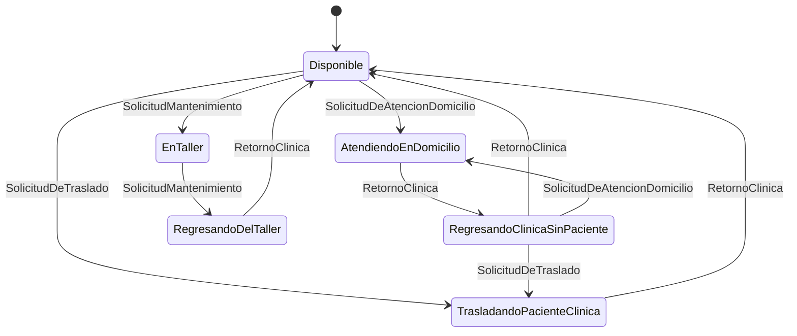

# Ambulance oracle: expected behaviour from the design documents

This is the oracle for both `mock-testing` and `concurrency-testing`. It was derived from the
design documents, **not** from the implementation. When the code disagrees with a row below, that
is a finding.

Sources:
- **[UML]** `docs/UML-State2.png`: the "create" arrows say which state creates which.
- **[JD]** Javadoc of each state class and of `Ambulancia` / `RetornoAutomatico`.
- **[INF]** `docs/Informe.pdf`, section "Ambulancia". It says:
  - the ambulance "notifica a observadores cuando la ambulancia se encuentra en un estado en el que
    no puede cumplir una solicitud";
  - it uses `synchronized` "para que no los usen varios hilos a la vez";
  - it uses `wait()` "para poner a dormir algunos hilos hasta que se cumpla una condición".
- **[README]** describes the State pattern for the ambulance and the Observer pattern for the view.

Rows marked **supuesto** are inferences that the documents support only indirectly. Write them in
the report as supuestos.

## 1. Transition table (State pattern)

The rows are the current state and the columns are the events (`State` interface methods). Each
cell gives the expected next state. **Rechaza** means the state does not change and the
observers are notified [INF].

| Estado actual | SolicitudDeTraslado | SolicitudDeAtencionDomicilio | SolicitudMantenimiento | RetornoClinica |
|---------------|---------------------|------------------------------|------------------------|----------------|
| Disponible | TrasladandoPacienteClinica [JD][UML] | AtendiendoEnDomicilio [JD][UML] | EnTaller [JD][UML] | Disponible: sin acción, "ya se encuentra en la clínica" [JD] |
| AtendiendoEnDomicilio | Rechaza [JD] | Rechaza [JD] | Rechaza [JD] | RegresandoClinicaSinPaciente [JD][UML] |
| TrasladandoPacienteClinica | Rechaza [JD] | Rechaza [JD] | Rechaza [JD] | **Disponible** [JD: "Cambia el estado de la ambulancia a DisponibleState"][UML] |
| EnTaller | Rechaza [JD] | Rechaza [JD] | RegresandoDelTaller [JD][UML] | Rechaza: "no puede retornar a la clínica" [JD] |
| RegresandoDelTaller | Rechaza [JD] | Rechaza [JD] | Rechaza [JD] | Disponible [JD][UML] |
| RegresandoClinicaSinPaciente | TrasladandoPacienteClinica [JD][UML] | AtendiendoEnDomicilio [JD][UML] | Rechaza [JD] | Disponible [JD][UML] |

The table has 24 cells. A complete state-transition test covers each cell once: 14 rejections or
no-ops and 10 real transitions.



## 2. Occupancy invariant

The Javadoc of each state constructor states the occupancy that the state implies:
- **ocupada**: AtendiendoEnDomicilio, TrasladandoPacienteClinica and EnTaller.
- **no ocupada**: Disponible, RegresandoClinicaSinPaciente and RegresandoDelTaller.

Hence the invariant, checked **after every completed operation** on the ambulance:

```
isOcupado() == (estado ∈ {AtendiendoEnDomicilio, TrasladandoPacienteClinica, EnTaller})
```

Who maintains the flag (the state constructor or `Ambulancia`) is an implementation detail. The
invariant is what the design promises. A state change that leaves the flag stale blocks waiting
threads forever, or lets two of them in.

## 3. `Ambulancia` method contract

| Método | Comportamiento esperado | Fuente |
|--------|-------------------------|--------|
| `atenderDomicilio(a)` | `a != null` (si no, `AssertionError`). Si está ocupada y la simulación activa, el hilo **espera** y se notifica que no hay ambulancia. Cuando queda libre, se ocupa, delega **una vez** `SolicitudDeAtencionDomicilio()` en el estado actual y notifica. Si la simulación terminó mientras esperaba, retorna **sin delegar** | [INF] wait/synchronized; [JD] |
| `trasladarALaClinica(a)` | Igual, delegando `SolicitudDeTraslado()` | ídem |
| `solicitarMantenimiento(o)` | Igual, delegando `SolicitudMantenimiento()` (`o != null`) | ídem |
| `regresarSinPaciente()` | Delega `RetornoClinica()`, libera la ambulancia, notifica y despierta a los hilos en espera | [JD], invariante §2 |
| `volviendoDelTaller()` | Delega `SolicitudMantenimiento()` (EnTaller → RegresandoDelTaller), libera, notifica y despierta | [JD], [UML] |
| `retornoAutomatico(r)` | Delega `RetornoClinica()` y despierta a los hilos en espera. Después se cumple el invariante §2 (**supuesto**: si el retorno deja a la ambulancia en un estado "no ocupada", tiene que quedar libre) | [JD] RetornoAutomatico, invariante §2 |
| `setSimulacionActiva(false)` | Despierta a **todos** los hilos en espera; los que esperaban retornan sin delegar | [JD] "despierta a todos los hilos esperando" |
| `verificarYFinalizarSimulacion()` | Si todos los asociados alcanzaron su máximo de solicitudes, termina la simulación, notifica y despierta a todos | [JD] |
| `setState(null)`, `agregarAsociado(null)` | `AssertionError` | precondición |
| Concurrencia en general | Ningún método modifica estado compartido sin exclusión mutua. Un hilo en espera no consume CPU. Ningún hilo queda en espera indefinida si la ambulancia se libera o la simulación termina | [INF] |

Notifications: [INF] describes the event types as INFO, ALERTA and ERROR. Assert that a
`NotificacionSimulacion` with a non-empty message reaches the observer. Assert a specific type
string only as a supuesto, and mention the mismatch between the documented and the actual type
names if you see one.

## 4. `RetornoAutomatico`

[JD]: "Periódicamente intenta retornar la ambulancia a la clínica mientras la simulación esté
activa". The interval is the constant `INTERVALO_RETORNO` (10 s).

Expected behaviour:
- While the simulation is active, the thread **stays alive** and, every ~10 s, calls
  `ambulancia.retornoAutomatico(this)`.
- When the simulation ends, the thread finishes within one interval.
- When the thread is interrupted, it finishes promptly. [JD]: "Salir limpiamente si el hilo es
  interrumpido".
- It must not hold the ambulance's lock while sleeping.
