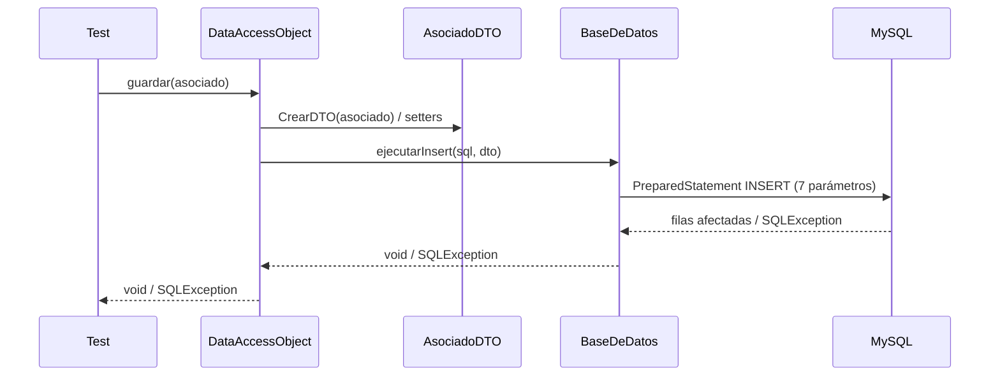

# Integration test design method

## 1. What integration testing is checking

Unit tests showed that each piece honours its own contract. Integration tests check what
happens **at the seams**. Typical seam problems:

- values that are valid on one side and invalid on the other (DTO allows `numero = 0`, but
  `Domicilio` requires `> 0`),
- parameters bound in a different order than the SQL expects,
- column names or types that don't match the mapping,
- resources whose lifecycle one side assumes and the other breaks (a closed connection, an
  unconsumed `ResultSet`, a Singleton reused after closing),
- errors from the external resource that are swallowed, wrapped, or turned into a different
  failure (an `SQLException` becoming a `NullPointerException`).

## 2. Strategy

- **Bottom-up** (default): start from the leaves (connection, then BaseDeDatos, then DAO). No
  stubs are needed, and each layer is tested on top of real, already-tested layers.
- **Top-down with mocks** is only for dependencies that don't exist yet, aren't deterministic,
  or when the assignment asks for mocks. The DB integration explicitly asks for the real engine,
  so here everything is real.

Write the decision as a table:

| Componente | Real / Mock | Motivo |
|------------|-------------|--------|
| MySQL 8 (Docker) | Real | La consigna exige comunicación real con el motor |
| BaseDeDatos | Real | Componente bajo prueba |
| DataAccessObject | Real | Componente bajo prueba |
| AsociadoDTO | Real | Atraviesa la interacción (mapeo) |
| Asociado / Domicilio | Real | Entrada del DAO; ya probadas en forma unitaria |

## 3. Element states

An element is anything with state that takes part in the interaction. For each one, list its
states and how a test provokes them:

| Elemento | Estados posibles | Cómo se provoca |
|----------|------------------|-----------------|
| Servidor MySQL | activo / caído | normal / ejecución aparte con el contenedor detenido |
| Tabla Asociados | con datos semilla / con un registro extra / sin el registro buscado | `@BeforeEach` restaura la semilla; INSERT/DELETE por JDBC propio |
| Singleton BaseDeDatos | sin crear / creado / conexión cerrada | primera llamada / normal / `cerrarConexion()` en un test aislado |
| Registro objetivo | existe / no existe | elegir id o DNI de la semilla o uno ausente |
| DNI | nuevo / repetido | valor no usado / DNI de la semilla |

Every element needs at least its normal state and one failure state.

## 4. Combining states and values into cases

1. Each **failure state** with every other element normal and normal values.
2. Each **representative value** (the ones that cross into SQL) with every element normal.
3. Critical combinations that the spec makes interesting. Example: "actualizar a record that
   is not the first one", because a hardcoded id only shows up when the target is not id 1.

The case table:

| Id | Entrada | Condiciones de entrada | Salida esperada | Condiciones de salida | Resultado |
|----|---------|------------------------|-----------------|-----------------------|-----------|
| CI5 | `dao.guardar(asociado con DNI "12345678")` | Semilla cargada; el DNI ya existe | `SQLIntegrityConstraintViolationException` | La tabla sigue con 20 filas (SELECT COUNT(*)) |

- **Salida esperada**: what the call returns or throws.
- **Condiciones de salida**: the state of the elements afterwards, checked by an independent
  query. That separation is what makes the table useful as a design: it says *how* each claim
  will be verified.

## 5. Sequence diagram template

Trace the real calls in the code. The diagram documents the interaction under test and
justifies which values cross:

## 6. Checklist before coding

- [ ] Every operation in the SRS §3.3 has at least one normal case and one failure case.
- [ ] The Singleton: same instance on repeated calls, and behaviour after `cerrarConexion`.
- [ ] `iniciarBD`: schema exists, table recreated, exact seed count and content (spot-check rows,
      including the first and the last).
- [ ] Each column round-trips with a **distinct** value, so swapped parameters are visible.
- [ ] Each schema length limit is tested at n and n+1.
- [ ] Unique constraint (DNI), missing record (id/DNI not present), boundary `limite` values.
- [ ] Every *condición de salida* names its independent query.
