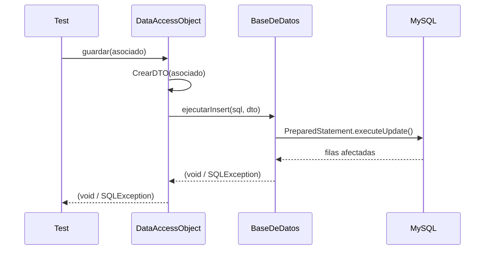

# Técnica de integración: guía operativa

Secciones: §1 estrategias y real frente a mock · §2 estados de los elementos · §3 valores
adecuados · §4 combinación y verificación · §5 diagrama de secuencia · §6 problemas OO ·
§7 ejemplos resueltos.

## §1. Estrategias (clase 08)

| Estrategia | Cómo | Necesita stubs/mocks | Cuándo |
|------------|------|----------------------|--------|
| Big bang | Todo junto de una vez | No | **No se recomienda**: es difícil aislar los errores |
| Descendente en profundidad | Desde `main`, rama por rama (una funcionalidad por rama) | Sí, para lo de abajo | La capa de abajo no existe o es costosa |
| Descendente en anchura | Desde `main`, nivel por nivel | Sí | Para validar temprano la estructura de control |
| **Ascendente** | Desde las hojas (módulos atómicos) hacia arriba | No | **Por defecto**, cuando lo de abajo existe y está probado |

**¿Real o mock?** Se usa un mock **solo** si la dependencia (clase 08):

- devuelve resultados **no determinísticos** (hora, aleatorios, hilos);
- tiene un **estado difícil de reproducir** (errores de conexión, un recurso ocupado);
- es **lenta** (BD, `sleep` largos);
- **todavía no existe**, o su comportamiento puede cambiar;
- o **la consigna lo pide** (por ejemplo, "probar el contexto ante la ausencia de los
  estados concretos").

**Nunca** se mockea la interacción que se quiere verificar. Mockear las dos puntas deja
una prueba unitaria con pasos extra.

## §2. Estados de los elementos y cómo provocarlos

| Elemento | Estados (cátedra) | Cómo se provoca en el test |
|----------|-------------------|----------------------------|
| Objeto colaborador | existe / no existe / versión inadecuada | Instancia real / `null` o sin inyectar / mock con otro comportamiento |
| BD | activa / inaccesible | `mysql.sh up` / `mysql.sh lock` (ejecución aparte, `database-jdbc.md` §6) |
| Esquema o tabla | presente / ausente / con datos semilla / vacía / con un registro duplicado | `@Before`: rutina de inicialización, `DROP TABLE`, `TRUNCATE` o `INSERT` directo por JDBC |
| Archivo | existe / no existe / formato inválido / sin permisos | `@Before`: crear, borrar, escribir contenido corrupto, `setReadable(false)` |
| Recurso compartido (monitor) | libre / ocupado | Un hilo auxiliar que lo toma; flags del objeto (`setOcupado(true)`) |
| Hilo | corriendo / en espera (`WAITING`) / terminado / interrumpido | `start`, sondear `getState()`, `join`, `interrupt()` |
| Bandera de ciclo de vida (simulación activa) | activa / inactiva | Setter del objeto antes o durante la prueba |

Los estados se expresan como **proposiciones** en la columna "Condiciones de entrada":
"BD activa, tabla con 5 registros semilla, DNI 123 no registrado".

## §3. Valores adecuados (*AtraviesaB*)

```
metA(x) {             x ∈ valores aceptables de metA
  ...
  if (x …)            solo algunos x provocan la llamada
     b.metB(y);       y ∈ AtraviesaB: los valores de y que metA puede producir
}
```

- Para integración interesan los `x` cuya `y` **atraviesa** hacia `ClaseB`. Los demás ya
  se cubrieron en la prueba unitaria de `metA`.
- Si los parámetros pasan **sin cambios** de una capa a otra (DTO → DAO → SQL), alcanza con
  las variables de entrada (como en el ejemplo de la cátedra: "solo se consideran dos variables").
- Para el mapeo entre capas se usan **valores distintos en cada campo**: así se detectan
  columnas o parámetros cruzados.

## §4. Combinación y verificación

**Combinación (como en la tabla de la cátedra):**

1. Cada **estado de falla** con el **valor normal**: "TClave ausente + juan/orion7 → falla de ejecución".
2. Cada **valor representativo** con **todos los estados normales**: "BD activa + juan/qwerty → error de contraseña".
3. Las **combinaciones críticas** que pida la especificación (duplicados con datos semilla,
   un límite con una tabla vacía).

No hace falta el producto cartesiano completo.

**Condiciones de salida:** el estado que tiene que quedar después del caso ("la tabla tiene
N+1 filas", "el estado actual es Disponible", "el hilo terminó", "el archivo existe").
Se verifican por un **camino independiente**:

| Se probó… | Se verifica con… |
|-----------|------------------|
| Una escritura del DAO | Un `SELECT` con una `Connection` propia del test, no el `cargar` del DAO |
| Una transición del contexto | `getEstadoActual()` (la clase del estado), o un mock que registró la llamada |
| Una notificación de Observer | Un `Observer` de prueba o un mock con `ArgumentCaptor` |
| La terminación de un hilo | `join(ms)` + `isAlive()` |

## §5. Diagrama de secuencia (plantilla)



Cada flecha es una interacción candidata; cada participante, un elemento con estados (§2).
La cátedra: "al menos un caso de prueba por diagrama de secuencia, usualmente más".

## §6. Problemas que busca la integración OO (repasar en el Paso 5)

- [ ] **Configuración:** versiones incompatibles (driver frente a servidor, Java frente a librerías).
- [ ] **Funciones faltantes o que no hacen lo esperado** en la clase invocada.
- [ ] **Uso incorrecto de archivos o BD:** esquema ausente, claves imprevistas, formato distinto, conexión no cerrada.
- [ ] **Integridad de datos:** restricciones (UNIQUE, NOT NULL) que el código no anticipa, o que la SRS exige y el esquema no tiene.
- [ ] **Método equivocado por polimorfismo o ligadura dinámica:** el estado o subtipo que efectivamente se ejecuta.
- [ ] **Parámetros erróneos:** orden, tipo, `null`, fuera de rango entre capas (constructores con órdenes distintos).
- [ ] **Conflictos de concurrencia:** carreras, deadlock, `wait` sin `notify`, hilos que no terminan.

## §7. Ejemplos resueltos

### 7.1 Cátedra: identificación de usuario (clase 08)

IUClave → TClave → (BD) → Dialogos. Estados: cada clase presente o ausente; BD activa o
con problemas. Valores: juan/orion7 (correcto), juan/qwerty (contraseña errónea),
juan/vacía, vacío/orion7, ulises/df7th (no registrado). Casos: 4 de "elemento ausente o
BD con problemas" con juan/orion7 → falla de ejecución, y 5 con todo presente → bienvenida
o el error correspondiente.

### 7.2 TP Clínica: persistencia (consigna 2; SRS §3.2–§3.3)

- **Estrategia:** ascendente, `AsociadoDTO` → `BaseDeDatos` → `DataAccessObject`, con
  **MySQL real** (la consigna pide comunicación real).
- **Estados:** BD activa o inaccesible; tabla con datos semilla, vacía o con un DNI ya cargado.
- **Casos tipo:** el Singleton (`assertSame` entre dos `getInstancia()`, conexión no nula);
  la inicialización (tabla presente y cantidad de semillas); el CRUD de ida y vuelta,
  verificado con JDBC propio; la carga con límite (0, 1, N, mayor que el total); el
  mapeo con valores distintos por campo; las consultas con parámetros (un valor con
  `' OR '1'='1` se guarda literal); las excepciones (DNI duplicado, BD inaccesible,
  guardar `null`).

### 7.3 TP Clínica: `Ambulancia` + `State` + `RetornoAutomatico` (consigna 3)

- **Con mocks (atómico):** `mock(State.class)` inyectado con `setState`; se verifica que
  cada operación de `Ambulancia` delegue en el método del estado y maneje las banderas y
  las notificaciones.
- **Integración de la máquina de estados:** estados reales; la secuencia de eventos se
  contrasta con las transiciones del **diseño documentado** (`docs/informe/03-informe-tpe2026.md`, UML 1).
- **Concurrencia:** varios hilos que piden la ambulancia; el hilo bloqueado en `wait()` se
  despierta al liberarse; `RetornoAutomatico` termina cuando la simulación se desactiva o
  se lo interrumpe. Su intervalo fijo es largo (ver `concurrency.md` §5).
