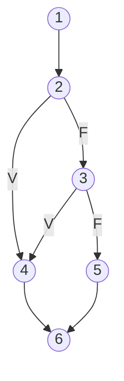

# Técnica de caja blanca: guía operativa

Secciones: §1 grafo por construcción de Java · §2 V(G) · §3 caminos básicos ·
§4 criterios de condición · §5 bucles · §6 ejemplos de la cátedra · §7 plantilla Mermaid ·
§8 JUnit para forzar caminos.

## §1. Del código al grafo (cómo numerar cada construcción)

Reglas de la cátedra: cada **condición** es un nodo; las **sentencias consecutivas sin
decisión** se agrupan en un nodo; los números son únicos.

| Construcción | Nodos predicado | Cómo se dibuja |
|--------------|-----------------|----------------|
| `if (c) {A}` | 1 | `c -V→ A → J`, `c -F→ J` (J = nodo de unión; puede ser la siguiente sentencia) |
| `if (c) {A} else {B}` | 1 | `c -V→ A → J`, `c -F→ B → J` |
| `if…else if…else` | 1 por condición | Cadena: el `F` de una condición va a la siguiente |
| `if (a \|\| b)` | **2** | `a -V→ THEN`; `a -F→ b`; `b -V→ THEN`; `b -F→ ELSE` (cortocircuito) |
| `if (a && b)` | **2** | `a -F→ ELSE`; `a -V→ b`; `b -V→ THEN`; `b -F→ ELSE` |
| `c ? x : y` | 1 | Igual que un `if/else` |
| `while (c) {A}` | 1 | `c -V→ A → c` (arco de vuelta); `c -F→ salida` |
| `for (i; c; inc) {A}` | 1 | `i → c`; `c -V→ A → inc → c`; `c -F→ salida` |
| `for (x : col)` | 1 | Como `while (hasNext())` |
| `do {A} while (c)` | 1 | `A → c`; `c -V→ A`; `c -F→ salida` |
| `switch` con *k* ramas (incluido `default`) | *k*−1 en V(G) | Un nodo con una salida por `case`. Sin `break` hay *fall-through*: arco de un `case` al siguiente |
| `return` / `throw` en el medio | 0 | Arco directo al nodo de **salida** |
| `break` / `continue` | 0 | Arco a la salida o a la condición del bucle |
| `try {A} catch (E) {B}` | 1 por cada `catch` que pueda ocurrir | `A -normal→ J`; `A -excepción→ B → J`. Solo si la excepción es **realizable** desde las entradas |
| `finally` | 0 | Se recorre por todos los caminos |
| `assert c : msg` | 1 | `c -V→ siguiente`; `c -F→ throw AssertionError → salida` (con `-ea`) |

## §2. Complejidad ciclomática

```
V(G) = arcos − nodos + 2
V(G) = regiones                 (cerradas + la exterior)
V(G) = nodos predicado + 1      (cada condición simple cuenta 1; un switch de k ramas cuenta k−1)
```

- Las 3 **tienen que coincidir**. La causa más común de que no coincidan es haber dejado un
  `&&` o `||` como un solo nodo, o haber olvidado el arco de vuelta de un bucle.
- V(G) es la **cota superior** de casos para la cobertura de decisión (no todos los caminos
  son realizables) y la **cantidad de caminos básicos**.
- Referencias de McCabe: 1–10 sencillo · 11–20 moderado · 21–50 alto · más de 50 inestable.
  Un método con V(G) > 10 se anota como riesgo en el informe.
- **JaCoCo** reporta la V(G) por método (contador COMPLEXITY). Cuenta cada `assert` como
  una decisión, igual que la tabla de §1. Si la manual no coincide con la de JaCoCo, revisar
  el grafo: lo más común es un `&&`/`||` que quedó como un solo nodo o un `assert` sin contar.
  (Verificado con JaCoCo 0.8.12: `assert x >= 0` da 2 ramas y V(G) = 2.)

## §3. Caminos básicos: método de la línea base

1. **Camino 1 (línea base):** el más simple realizable de punta a punta; por lo general,
   todas las decisiones en su salida "natural" (por ejemplo, salir del bucle sin entrar).
2. **Camino siguiente:** tomar el camino anterior e **invertir una sola decisión** que todavía
   no se haya invertido, completando el resto por el recorrido más corto.
3. Repetir hasta tener **V(G) caminos**. Cada camino nuevo agrega al menos un arco nuevo.
4. Verificar que la unión de los caminos recorre **todos los arcos**.
5. **Camino no realizable** (ninguna entrada lo produce; por ejemplo, dos condiciones que
   se excluyen): marcarlo, buscar otro camino básico que agregue el mismo arco y, si no
   existe, justificarlo. Suele indicar código muerto: es un hallazgo para informar.

Notación de la cátedra: secuencia de nodos separados por comas, con los nodos agrupados
unidos por guion: `1, 2-3, 6, 7, 9, 10, 1, 11`.

## §4. Criterios de condición (solo con condiciones compuestas)

Con `(a > 10) || (b < 100)`:

| Criterio | Casos (a, b) | Resultado | Comentario |
|----------|--------------|-----------|------------|
| Condición simple | (12 V, 120 F), (8 F, 50 V) | V, V | Cada condición toma V y F, pero la **decisión nunca da F**: es débil |
| Condición múltiple (2ⁿ) | (12,120), (12,50), (8,50), (8,120) | V, V, V, F | Todas las combinaciones; crece exponencialmente |
| **Mínima múltiple** | (12 V, 120 F), (8 F, 50 V), (8 F, 120 F) | V, V, F | Solo las combinaciones en que **cambiar una condición cambia el resultado**: entre n+1 y 2ⁿ |

Receta para la mínima múltiple con *n* condiciones: para cada condición, un par de casos
que difieran **solo en esa condición** y den resultados distintos, con el resto fijado en un
valor neutro (`F` para `||`, `V` para `&&`). Se eliminan los repetidos.

**Por qué importa en Java:** por el cortocircuito, en `a || b` con `a = V` la condición `b`
**ni se evalúa**. Si `b` tiene un efecto (una llamada a un método) o un defecto (un NPE),
solo aparece con `a = F`.

## §5. Bucles (solo si hay bucles)

| Bucle | Casos |
|-------|-------|
| Simple, sin máximo | 0 iteraciones; 1; 2; varias |
| Simple, con máximo *m* | 0; 1; *m*−1; *m*; *m*+1 (si se puede forzar) |
| Anidados | Fijar el externo en 1 iteración y aplicar la tabla al interno; después al revés |
| Concatenados independientes | Cada uno por separado |

Para la cobertura de decisión alcanza con una iteración y con la no entrada. Los casos de
2 y de *m* son de **cobertura de camino** y apuntan a los errores de ±1.

## §6. Ejemplos resueltos de la cátedra

### 6.1 Media de x e y (clase 06)

```java
R = 0;                                    // (1)
if (x < 0 || y < 0)                       // (2) x<0 · (3) y<0
    System.out.println("x o y son neg");  // (4)
else {
    R = (x + y) / 2;                      // (5)
    System.out.println("La media es;" + R);
}                                         // (6)
```

Arcos: 1→2, 2V→4, 2F→3, 3V→4, 3F→5, 4→6, 5→6 (7 arcos, 6 nodos). V(G) = 7−6+2 = 3 = 2
predicados + 1 = 3 regiones.
Caminos: C1 `1-2-4-6` (x = −1), C2 `1-2-3-4-6` (x = 1, y = −1), C3 `1-2-3-5-6` (x = 20,
y = 10 → "La media es: 15"). La diapositiva propone x = 0 e y = 0 para C1 y C2, pero con 0
las condiciones `< 0` son falsas y se recorre C3.

### 6.2 `while (a == 10)` con 2 `if` anidados (clase 06)

Nodos: 1 (`a == 10`), 2-3 (println + `b == 20`), 4-5 (dos println), 6 (`c == 30`), 7, 8,
9 (println), 10 (`a = lector.nextInt()`), 11 (salida). 11 arcos, 9 nodos: **V(G) = 4**.

| Id | Camino | Datos y procedimiento | Salida esperada |
|----|--------|-----------------------|-----------------|
| T1 | 1, 11 | a = 11 | "a no es igual a 10" |
| T2 | 1, 2-3, 4-5, 10, 1, 11 | a = 10, b = 20; ingresar 11 | "a es igual a 10", "a sigue siendo igual a 10", "b es igual a 20", "a no es igual a 10" |
| T3 | 1, 2-3, 6, 7, 9, 10, 1, 11 | a = 10, b = 21, c = 30; ingresar 11 | "a es igual a 10", "c es igual a 30", "b no es 20 y se imprimió el valor de c", "a no es igual a 10" |
| T4 | 1, 2-3, 6, 8, 9, 10, 1, 11 | a = 10, b = 21, c = 31; ingresar 11 | "a es igual a 10", "c no es igual a 30", "b no es 20 y se imprimió el valor de c", "a no es igual a 10" |

## §7. Plantilla Mermaid del grafo



Debajo del grafo, listar los nodos (con lo que agrupa cada uno), los arcos, los predicados y
las regiones (R1…Rk), para que se puedan verificar las 3 fórmulas.

## §8. JUnit 4 para forzar caminos

```java
private final PrintStream outOriginal = System.out;
private final InputStream inOriginal = System.in;
private ByteArrayOutputStream salida;

@Before
public void capturarConsola()
{
    salida = new ByteArrayOutputStream();
    System.setOut(new PrintStream(salida, true));
}

@After
public void restaurarConsola()
{
    System.setOut(outOriginal);
    System.setIn(inOriginal);
}

@Test
public void t2_camino2_bEs20()
{
    System.setIn(new ByteArrayInputStream("11\n".getBytes()));   // lo que leerá lector.nextInt()
    // armar a = 10, b = 20 y ejecutar…
    String texto = salida.toString();
    assertTrue("debería imprimir 'b es igual a 20'", texto.contains("b es igual a 20"));
}
```

- Si el código crea su `Scanner` **antes** del `System.setIn` (por ejemplo, en un campo
  `static`), la redirección no tiene efecto. Es un límite de testabilidad para informar.
- Para forzar una rama que depende del **estado**, armar el escenario con la API pública.
  Si no hay forma, el camino es no realizable desde afuera: se justifica (§3, punto 5).
- La rama `catch` de una excepción que el entorno no puede provocar (por ejemplo, un
  `SQLException` sin BD) se cubre en `testing-integration` o se justifica.
