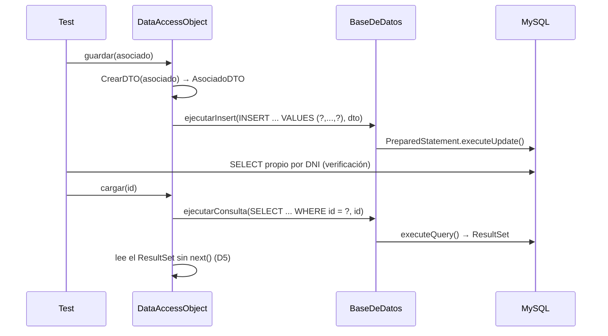

# Testing de integración con MySQL

## Objetivo y alcance

Verificar la comunicación entre `AsociadoDTO`, `DataAccessObject`, `BaseDeDatos` y el motor MySQL
(ítem 2 de la consigna): el patrón Singleton de la conexión, la creación automática del esquema,
de la tabla y de los datos semilla, y las operaciones CRUD con consultas parametrizadas. Además,
demostrar que la suite atrapa excepciones de SQL, errores de mapeo e inconsistencias del código
provisto.

Fuera de alcance: la vista y el controlador, que solo invocan al DAO.

Suites (`@Tag("integration")`, paquete `item2`):

- `DatabaseIntegrationTest`: Singleton, esquema, tabla y datos semilla (CI1–CI6).
- `DataAccessObjectIntegrationTest`: CRUD, consultas parametrizadas, errores de SQL y de mapeo
  (CI7–CI22).
- `support/DatabaseTestSupport`: utilidades de la suite (conexión propia y reinicio del
  Singleton). No contiene casos.

## Criterio de validación y supuestos

**Criterio de validación.** SRS §3.2 y §3.3:

- *"El componente aplicará el patrón de diseño Singleton para restringir la instanciación a un
  único manejador de conexión activo durante toda la ejecución."*
- *"Al inicializarse, el sistema ejecutará automáticamente una rutina de configuración del entorno
  (iniciarBD) para: verificar o crear el esquema de base de datos objetivo, eliminar y recrear la
  tabla Asociados, poblarla con registros iniciales de prueba."*
- *"El sistema aceptará una entidad de asociado, validará que no sea nula, la convertirá al formato
  DTO y ejecutará una inserción SQL persistente."*
- *"El sistema proveerá mecanismos para recuperar registros de asociados: de manera individual por
  su identificador único, en lotes acotados con un límite especificado, como una colección completa
  desde la base de datos."*
- *"El sistema modificará registros existentes o eliminará entradas basándose en criterios únicos
  como el número de documento (DNI)."*

Se suman las reglas de SRS §3.1 (ningún campo nulo, `numero` ≥ 0, el DNI es identificador único),
el uso de `PreparedStatement` "para prevenir vulnerabilidades de inyección SQL" (SRS §3.2) y los
contratos Javadoc de cada método (`pre`, `post` y `@throws SQLException`).

**Dónde se prueba cada cosa.** La SRS §3.2 le asigna a `BaseDeDatos` la conexión, el Singleton y la
rutina `iniciarBD()`; eso se prueba directamente sobre `BaseDeDatos`. La SRS §3.3 define al DAO
como el componente que "expone los servicios de persistencia a la lógica de la aplicación", así que
el CRUD se prueba a través del DAO. Los métodos `ejecutarInsert`, `ejecutarConsulta`,
`ejecutarActualizacion` y `ejecutarDelete` de `BaseDeDatos` se ejercitan igual, porque el DAO los
llama.

**Precondiciones.** Con el mismo criterio que el ítem 1, las reglas de validación de la SRS y los
`pre:` del Javadoc son precondiciones, y las entradas que las violan no se prueban: `guardar(null)`
y `actualizar(null)` (`pre: asociado no debe ser nulo`), `cargar(0)` (`pre: id > 0`),
`cargarConLimite(0)` (`pre: limite > 0`) y un DNI vacío o nulo en `eliminar` (el DNI "no puede ser
nulo", SRS §3.1). La SRS dice que el guardado "validará que no sea nula" la entidad, pero el
Javadoc lo declara como precondición; se sigue el criterio de la cátedra y no se prueba.

**Supuestos** (lo que la especificación no dice):

| Id | Supuesto | Justificación |
|----|----------|---------------|
| S4 | `cargar` con un id inexistente devuelve `null` | El Javadoc solo describe el caso existente |
| S5 | `actualizar` y `eliminar` con un DNI inexistente no lanzan excepción y no cambian ninguna fila | Comportamiento habitual de un `UPDATE`/`DELETE` sin coincidencias |
| S6 | Después de `cerrarConexion()`, `getInstancia()` entrega una conexión usable | SRS §3.2: "un único manejador de conexión **activo**" |
| S7 | Las cargas devuelven las filas en el orden del id | La SRS no define un orden; InnoDB devuelve por clave primaria |

## Estrategia de integración

| Componente | Real / Mock | Motivo |
|------------|-------------|--------|
| MySQL 8 | Real | La consigna pide verificar la comunicación con el motor |
| `BaseDeDatos` | Real | Componente bajo prueba |
| `DataAccessObject` | Real | Componente bajo prueba |
| `AsociadoDTO` | Real | Atraviesa la integración (mapeo) |
| `Asociado`, `Domicilio` | Real | Entrada del DAO |

- **Integración ascendente.** Primero `BaseDeDatos` sola contra MySQL y después el DAO encima: si
  falla un CRUD, ya se sabe que la conexión y la tabla están bien. Un mock de JDBC escondería
  justamente los errores de SQL y de mapeo que la consigna pide encontrar.
- **Verificación independiente.** Toda escritura se comprueba con una conexión JDBC propia del test
  y SQL propio, nunca leyendo con el mismo DAO. Si `guardar` pusiera la calle en la columna de la
  ciudad y `cargar` la leyera al revés, una ida y vuelta con el DAO pasaría igual. Que el dato se
  vea desde otra conexión prueba además que la inserción es persistente.
- **Estado conocido en cada test.** El `@BeforeEach` descarta el Singleton por reflexión (sin tocar
  el código) y crea uno nuevo; al crearse, `BaseDeDatos` ejecuta `iniciarBD()`, que recrea la tabla
  con los 20 datos semilla. Así un test no hereda lo que dejó el anterior, ni siquiera la conexión
  cerrada de CI6.
- **Datos distintos en cada campo** (`"Valentino"`, `"Hernan"`, `"40111222"`, `"Calle"`, `777`,
  `"Ciudad"`, `"2230001111"`), para que un cruce de columnas se note.

Secuencia de `guardar` y de `cargar`, trazada sobre el código:

## Estados del entorno y valores representativos

| Elemento | Estados | Cómo se provoca |
|----------|---------|-----------------|
| Esquema `Grupo_7` | existe / no existe | Normal / `DROP DATABASE` propio (CI2) |
| Tabla `Asociados` | con la semilla / con una fila extra / con una fila con `numero = 0` / inexistente | `@BeforeEach` / `INSERT` o `DROP TABLE` propios |
| Singleton | recién creado / conexión cerrada | `@BeforeEach` / `cerrarConexion()` |
| Fila buscada | existe / no existe | id o DNI de la semilla / uno ausente |
| DNI | nuevo / repetido / con SQL inyectado | `"40111222"` / `"12345678"` / `"' OR '1'='1"` |

Parámetros del DAO: `id` ∈ {1 (primera fila), 20 (última), 21 (inexistente)}; `limite` ∈ {1, 20
(igual a la cantidad de filas), 21 (mayor)}.

## Casos de prueba

| Id | Operación y entrada | Resultado esperado | Resultado |
|----|---------------------|--------------------|-----------|
| CI1 | `getInstancia()` dos veces | La misma instancia | ✅ |
| CI2 | Se borra el esquema y se crea el Singleton | `iniciarBD()` recrea `Grupo_7` | ✅ |
| CI3 | Inicialización | La tabla tiene id y los siete atributos del asociado | ✅ |
| CI4 | Inicialización | 20 filas semilla, sin nulos, `numero` ≥ 0, DNI distintos | ✅ |
| CI5 | `iniciarBD()` con una fila extra | Se recrea la tabla: vuelve a 20 filas | ✅ |
| CI6 | `cerrarConexion()` y luego `getInstancia()` | Conexión activa (S6) | ❌ D4 |
| CI7 | `guardar` con datos válidos | Fila nueva con cada dato en su columna | ✅ |
| CI8 | `guardar` con el DNI de la fila 1 | `SQLIntegrityConstraintViolationException` y 20 filas | ✅ |
| CI9 | `cargar(1)` | DTO igual a la fila 1 | ❌ D5 |
| CI10 | `cargar(20)` | DTO igual a la fila 20 | ❌ D5 |
| CI11 | `cargar(21)` | `null` (S4) | ❌ D5 |
| CI12 | `cargarConLimite(1)` | Solo la fila 1 | ✅ |
| CI13 | `cargarConLimite(20)` | 20 elementos | ✅ |
| CI14 | `cargarConLimite(21)` | 20 elementos | ✅ |
| CI15 | `cargarBD()` | La tabla completa, cada DTO igual a su fila | ✅ |
| CI16 | `actualizar` el asociado de la fila 7 (DNI `22334455`) | Cambia la fila 7 y ninguna otra | ❌ D6 |
| CI17 | `actualizar` un DNI inexistente | Ninguna fila cambia (S5) | ❌ D6 |
| CI18 | `eliminar` un DNI existente | 19 filas; el DNI ya no está | ✅ |
| CI19 | `eliminar` un DNI inexistente | La tabla intacta (S5) | ✅ |
| CI20 | `eliminar("' OR '1'='1")` | El texto se usa como valor del parámetro: la tabla intacta | ✅ |
| CI21 | `cargarBD()` con una fila con `numero = 0` | 21 DTO, el último con `numero` 0 | ✅ |
| CI22 | `cargarBD()` sin la tabla | `SQLException` hacia el llamador (Javadoc `@throws`) | ✅ |

## Resultados

La suite se ejecutó una vez contra MySQL 8.0.40, sobre el código del ítem 2: el código entregado
con el defecto D3 de `AsociadoDTO` corregido (`6cda0de`), como pide la consigna.

<!-- PENDIENTE: regenerar resultados/integration.{md,log} con run_tests.sh integration después de
commitear los cambios del branch. Los valores de esta tabla salen de la corrida del 06/11. -->

| Total | Pasan | Fallan |
|-------|-------|--------|
| 22 | 16 | 6 |

**Pasan 16 casos**: el Singleton entrega siempre la misma instancia, `iniciarBD()` crea el esquema,
la tabla y los datos semilla, y `guardar`, `cargarConLimite`, `cargarBD` y `eliminar` funcionan
como dice la SRS. CI20 muestra que las consultas usan parámetros: un DNI con SQL inyectado no
borra nada. CI21 muestra que, con D3 corregido, una fila con `numero = 0` se lee bien desde la base.

**Fallan 6 casos**, y cada uno se revisó contra el código para confirmar que la causa es un defecto y
no un error del test. Son los defectos D4, D5 y D6, que están en `BaseDeDatos` y `DataAccessObject`.
La consigna no pide corregir esas clases, sino demostrar que la suite los detecta: que esos casos
fallen es esa demostración.

Como el código entregado no compila (D1 y D2), la suite se ejecutó sobre una copia temporal del
proyecto con esos dos arreglos aplicados, que no se sube al repositorio (ver Apéndice C). La tabla
completa está en el Apéndice A (`resultados/integration.md`).

## Qué atrapa la suite

La consigna pide demostrar cómo la suite atrapa excepciones de SQL, errores de mapeo e
inconsistencias del código provisto:

| Categoría | Evidencia | Casos |
|-----------|-----------|-------|
| Excepciones de SQL | La violación de unicidad del DNI y la tabla inexistente llegan a quien llama al DAO como `SQLException` | CI8, CI22 (pasan) |
| Errores de mapeo | D5: `cargar` lee el `ResultSet` sin `next()` y falla al convertir la fila en DTO | CI9–CI11 (fallan) |
| Errores de mapeo | Cada DTO cargado coincide campo por campo con su fila, incluida una con `numero = 0` | CI15, CI21 (pasan) |
| Inconsistencias | D6: `actualizar` siempre modifica la fila 1, no la del DNI | CI16, CI17 (fallan) |
| Inconsistencias | D4: después de cerrar la conexión, el Singleton entrega un manejador inutilizable | CI6 (falla) |

## Defectos detectados

| Id | Ubicación | Descripción | Detectado por | Estado |
|----|-----------|-------------|---------------|--------|
| D3 | `AsociadoDTO.setNumero` | Rechaza 0: una fila válida con `numero = 0` rompe `cargarBD()` al mapearla | CU4, CI21 | Corregido (`6cda0de`) |
| D4 | `BaseDeDatos.getInstancia` | Después de `cerrarConexion()` sigue entregando el mismo manejador, con la conexión cerrada | CI6 | No se corrige |
| D5 | `DataAccessObject.cargar` | Lee el `ResultSet` sin llamar a `next()`: lanza `SQLException` incluso para un id existente | CI9, CI10, CI11 | No se corrige |
| D6 | `BaseDeDatos.ejecutarActualizacion` | Fija `WHERE id = 1` (`setInt(8, 1)`): siempre modifica la fila 1, no la del DNI | CI16, CI17 | No se corrige |

D6 se manifiesta de dos maneras. En CI16 el `UPDATE` intenta poner en la fila 1 el DNI de la fila 7
y MySQL lo rechaza por el `UNIQUE` (`Duplicate entry '22334455'`). En CI17, con un DNI nuevo, la
fila 1 se sobrescribe sin error: es una pérdida de datos silenciosa.

D3 se detectó en el ítem 1 (CU4) y se corrigió acá, porque la consigna lo pide. CI21 es el caso de
integración que lo cubre: con el `AsociadoDTO` entregado, una fila válida con `numero = 0` hace
fallar la carga completa de la tabla.

## Observaciones de revisión de código

Puntos que ningún test detecta:

- El esquema que crea `iniciarBD()` no declara ninguna columna `NOT NULL`: la tabla acepta un
  asociado sin DNI. No se registra como defecto porque el sistema nunca puede enviarlo: el DNI no
  nulo es una precondición de `AsociadoDTO`.
- Los largos de las columnas (`VARCHAR(30)` para nombre, apellido y calle, `VARCHAR(35)` para
  ciudad, `VARCHAR(10)` para DNI y `VARCHAR(15)` para teléfono) no figuran en la SRS, que solo pide
  que los campos no sean nulos. Se recomienda que la especificación los defina.
- `CrearDTO(int id, …)` recibe el `id` y lo ignora; `AsociadoDTO` ni siquiera tiene ese campo.
- `ejecutarConsulta` nunca cierra el `PreparedStatement` (pérdida de recursos).
- `abrirConexion` e `iniciarBD` atrapan la `SQLException` y solo la imprimen. Con el servidor caído,
  `getInstancia()` devuelve un objeto con la conexión en `null` y el error aparece después como
  `NullPointerException`. Se observó al preparar el entorno (ver Apéndice C).
- El Javadoc de `eliminar` dice "pre: id debe ser mayor que 0", pero el método recibe un DNI.
- La fila semilla 4 tiene la ciudad `' Mar del Plata'`, con un espacio adelante.
- `Domicilio` exige `numero > 0` y la SRS admite `numero ≥ 0`: un asociado con número 0 no puede
  ni crearse para llegar a `guardar`.
- `getInstancia()` no es `synchronized`: el Singleton no es seguro si lo piden varios hilos a la vez.

## Fallas sembradas

Sin modificar el código, la capacidad de detección se demuestra con la base en estados forzados
desde el test: una fila con `numero = 0` (CI21), la tabla borrada (CI22), el esquema borrado (CI2)
y la conexión cerrada (CI6).

## Conclusiones

- La suite cubre el Singleton, la inicialización y las cuatro operaciones CRUD con 22 casos, y
  detectó tres defectos nuevos (D4, D5 y D6) que la prueba unitaria no podía ver: todos dependen del
  SQL, del esquema o del ciclo de vida de la conexión.
- La verificación con SQL propio fue determinante en D6: con un DNI nuevo, `actualizar` no lanza
  error y una lectura con el mismo DAO no habría mostrado que se pisó la fila 1.
- CI21 muestra cómo un defecto unitario (D3) reaparece como error de mapeo en la integración: una
  fila que la SRS considera válida hacía fallar la carga completa de la tabla. Con `AsociadoDTO`
  corregido, CI21 pasa sin tocar nada de la persistencia: el problema estaba en el DTO, y la
  integración lo mostraba de otra forma.
- CI20 confirma que las operaciones usan consultas con parámetros: el DAO no es vulnerable a una
  inyección SQL a través del DNI.
- Limitaciones: la suite depende de que MySQL esté levantado con el usuario de
  `docker-compose.yml` y de `-ea`. Tampoco verifica el `id` de los DTO cargados, porque
  `AsociadoDTO` no tiene ese campo.
