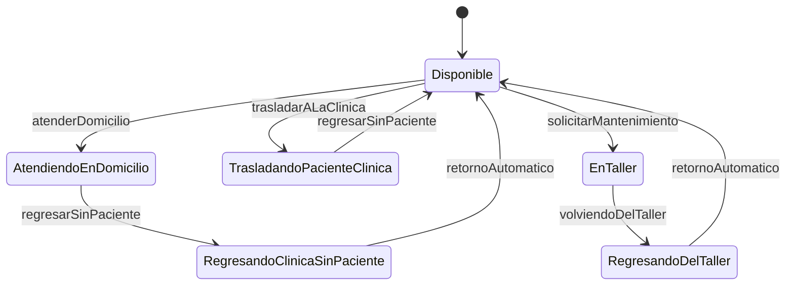

# Testing de integración y concurrencia: máquina de estados de la Ambulancia

## Objetivo y alcance

Evaluar el flujo completo de la máquina de estados real acoplada a `Ambulancia`, y la gestión del
recurso compartido entre hilos independientes: bloques `synchronized`, `wait`/`notifyAll` y el hilo
`RetornoAutomatico` (segunda parte del ítem 3 de la consigna). Además, demostrar que la suite
descubre problemas de sincronización y fallos de estado.

Suites (`@Tag("concurrency")`, sin mocks):

- `AmbulanciaMaquinaDeEstadosTest` (CC1–CC5): flujos completos en un solo hilo, con los estados
  reales.
- `AmbulanciaConcurrenciaTest` (CC6–CC13): hilos que compiten por la ambulancia.

## Oráculo y supuestos

**Oráculo.** La tabla de transiciones de la sección de mocks (UML y Javadoc), el contrato de
`Ambulancia` (Javadoc), el Javadoc de `RetornoAutomatico` (*"periódicamente intenta retornar la
ambulancia a la clínica mientras la simulación esté activa"*), y el informe de diseño, que dice que
la ambulancia usa `synchronized` *"para que no los usen varios hilos a la vez"* y `wait()` *"para
poner a dormir algunos hilos hasta que se cumpla una condición específica"*.

**Invariante de ocupación.** El Javadoc del constructor de cada estado dice si la ambulancia queda
ocupada. De ahí sale la regla que se verifica después de cada operación:

> `isOcupado()` es verdadero si y solo si el estado es AtendiendoEnDomicilio,
> TrasladandoPacienteClinica o EnTaller.

Si el indicador queda desactualizado, los hilos que esperan la ambulancia se bloquean de más o
entran dos a la vez.

**Supuestos:**

| Id | Supuesto | Justificación |
|----|----------|---------------|
| S16 | Después del retorno automático también se cumple el invariante | Si no, los hilos que esperan siguen bloqueados aunque la ambulancia esté regresando |
| S17 | Un pedido que el estado rechaza no deja la ambulancia ocupada | Sale del invariante. Choca con el contrato literal ("se ocupa, delega"), que no prevé el rechazo |
| S18 | Ningún hilo duerme con el lock de la ambulancia tomado | Buena práctica de concurrencia: una espera dentro de un bloque `synchronized` frena a todos los demás hilos |
| S19 | Una simulación chica (2 asociados con 1 solicitud) termina en menos de 2 minutos | El plazo sale de las esperas al azar de `TiempoMuerto` (hasta 8 s cada una), no de la especificación |

## Recursos compartidos e hilos

| Recurso | Quién lo usa | Protección |
|---------|--------------|------------|
| `estadoActual` | Asociados, operario, `RetornoAutomatico` | `setState` es `synchronized`; `getEstadoActual` no, y el campo no es `volatile` |
| `ocupado` | Todos | Getter y setter `synchronized` |
| `isSimulacionActiva` | Todos y `Clinica.finalizarSimulacion` | Getter y setter `synchronized` |
| Lista `asociados` | `Clinica` (agrega), operario (recorre) | `agregarAsociado` no es `synchronized` |
| Monitor de la ambulancia | `wait()` en los pedidos; `notifyAll()` en las liberaciones y al terminar la simulación | Los `wait()` están dentro de un `while` |

## Flujos de la máquina de estados

Los casos CC1 a CC5 usan solo los métodos públicos de `Ambulancia`, en un solo hilo:

## Técnicas para que los resultados no dependan de la suerte

- **Nunca se espera un tiempo fijo.** Se espera una condición observable (un hilo en `WAITING`, un
  cambio de estado) con un plazo máximo. Si el plazo vence, el test falla con un mensaje claro.
- **Plazos holgados** (5 s para despertar un hilo, 15 s para el retorno automático), para que una
  máquina cargada no produzca falsos rojos.
- **Hilos daemon y una ambulancia nueva por test.** Un hilo que queda bloqueado por un defecto no
  cuelga la ejecución ni afecta al test siguiente.
- **Hilos propios del test** en lugar de `Asociado` y `Operario`, que duermen tiempos al azar. Solo
  CC12 usa los hilos reales de la aplicación.
- **Sin mediciones en milisegundos.** CC11 empezó midiendo la demora de `isOcupado()` con un umbral
  de 200 ms y, con la máquina cargada, dio un falso verde. Ahora verifica que la consulta responda
  mientras el otro hilo sigue durmiendo.

## Casos de prueba

| Id | Escenario e hilos | Acciones | Resultado esperado | Resultado |
|----|-------------------|----------|--------------------|-----------|
| CC1 | Un hilo | Domicilio → regreso → retorno automático | AtendiendoEnDomicilio (ocupada), RegresandoClinicaSinPaciente (libre), Disponible (libre) | ✅ |
| CC2 | Un hilo | Traslado → regreso | Trasladando (ocupada), Disponible (libre) | ❌ D10 |
| CC3 | Un hilo | Mantenimiento → vuelta del taller → retorno automático | EnTaller (ocupada), RegresandoDelTaller (libre), Disponible (libre) | ✅ |
| CC4 | Un hilo | Domicilio → retorno automático | RegresandoClinicaSinPaciente y libre (S16) | ❌ D11 |
| CC5 | Un hilo | Mantenimiento → vuelta del taller → pedido de domicilio | Sigue RegresandoDelTaller y libre (S17) | ❌ D12 |
| CC6 | El test ocupa la ambulancia; otro hilo pide un traslado | Esperar el estado del hilo | El hilo queda en `WAITING` y el estado no cambia | ✅ |
| CC7 | Ídem | `regresarSinPaciente()` | El pedido se despierta y la ambulancia queda Trasladando | ✅ |
| CC8 | El operario ocupa la ambulancia; un asociado espera | `volviendoDelTaller()` | El pedido se despierta | ✅ |
| CC9 | Dos hilos esperan la ambulancia ocupada | `setSimulacionActiva(false)` | Los dos terminan sin delegar en el estado | ✅ |
| CC10 | `RetornoAutomatico` con la simulación activa | Esperar hasta 15 s | La ambulancia vuelve a Disponible | ❌ D13 |
| CC11 | Un hilo hace el retorno desde Trasladando; el test consulta `isOcupado()` | Consultar mientras el retorno está en curso | Responde sin esperar a que termine el retorno (S18) | ❌ D14 |
| CC12 | 2 `Asociado`, 1 `Operario` y `RetornoAutomatico` reales | Esperar a que terminen | Todos los hilos terminan en menos de 2 minutos (S19) | ✅ |
| CC13 | Falla sembrada FC1: ambulancia de prueba sin `notifyAll()` | El escenario de CC7 | El escenario detecta la falla: el pedido no se despierta | ✅ |

## Resultados

Ejecución del 31/10/2026, sobre el código provisto con solo las correcciones de compilación D1 y D2
aplicadas. Esas correcciones se revirtieron después por indicación de la cátedra: con el código tal
como se entregó la suite no compila (ver la sección de integración con MySQL).

| Suite | Total | Pasan | Fallan |
|-------|-------|-------|--------|
| `AmbulanciaMaquinaDeEstadosTest` | 5 | 2 | 3 |
| `AmbulanciaConcurrenciaTest` | 8 | 6 | 2 |
| Total | 13 | 8 | 5 |

Los casos concurrentes son deterministas: un hilo solo entra en `WAITING` dentro de `wait()`, y solo
lo despierta un `notifyAll()` del código. Por eso no hace falta repetirlos para estimar una tasa de
detección.

## Defectos detectados

| Id | Ubicación | Descripción | Detectado por |
|----|-----------|-------------|---------------|
| D10 | `TrasladandoPacienteClinicaState.RetornoClinica` | Pasa a RegresandoDelTaller en lugar de Disponible | CM24, CC2 |
| D11 | `Ambulancia.retornoAutomatico` | Cambia el estado pero no libera la ambulancia | CC4 |
| D12 | `atenderDomicilio`, `trasladarALaClinica`, `solicitarMantenimiento` | Ocupan la ambulancia y notifican éxito aunque el estado rechace el pedido | CC5 |
| D13 | `RetornoAutomatico.run` | La condición del `while` está invertida: con la simulación activa el hilo termina enseguida y nunca devuelve la ambulancia | CC10 |
| D14 | `TrasladandoPacienteClinicaState.RetornoClinica` | `Thread.sleep(1000)` dentro de un método `synchronized`: bloquea la ambulancia a todos los hilos durante 1 s | CC11 |

## Fallas sembradas

Como el código de producción no se modifica, la falla se introduce con un doble de prueba definido
en la suite. `AmbulanciaSinNotifyAll` es una subclase de `Ambulancia` cuyo `regresarSinPaciente()` no
llama a `notifyAll()`. CC13 corre sobre ella el mismo escenario de CC7 y comprueba que el pedido en
espera ya no se despierta: el escenario detecta la falla sembrada.

| Id | Falla sembrada | Detectada por | Resultado |
|----|----------------|---------------|-----------|
| FC1 | Falta `notifyAll()` al liberar la ambulancia | El escenario de CC7 (en CC13) | Detectada |

## Observaciones de revisión de código

- `getEstadoActual()` no es `synchronized` y el campo no es `volatile`: otro hilo puede ver un estado
  viejo. No se pudo reproducir de forma confiable con un test.
- En `Clinica.iniciarSimulacion` cada asociado se agrega dos veces a la lista de la ambulancia (en
  el constructor de `Asociado` y otra vez en `Clinica`).
- `TrasladandoPacienteClinicaState.RetornoClinica` atrapa `Exception` sin hacer nada: si el hilo es
  interrumpido, la interrupción se pierde.
- Por D13, `RetornoAutomatico` nunca llega a ejecutar su ciclo en CC12: la simulación completa
  termina igual, pero sin el retorno automático.

## Conclusiones

- La máquina de estados real confirmó D10, que los mocks ya habían ubicado, y encontró dos
  defectos que los mocks no podían ver porque surgen de combinar la ambulancia con los estados
  reales: el indicador de ocupación queda desactualizado después del retorno automático (D11) y
  después de un pedido rechazado (D12).
- Solo los hilos reales mostraron D13 y D14. D13 es el más grave del ítem: el hilo de retorno
  automático, que según el informe de diseño es "vital para la simulación", termina apenas arranca.
- La exclusión mutua y los despertares (CC6 a CC9) funcionan bien, y la falla sembrada FC1 muestra
  que esos escenarios detectarían un `notifyAll()` faltante.
- Limitaciones:
  - Que estos casos den verde no prueba la ausencia de condiciones de carrera. Por ejemplo, el
    problema de visibilidad de `getEstadoActual()` quedó como observación.
  - CC12 depende de esperas al azar y tarda entre 20 y 60 s.
